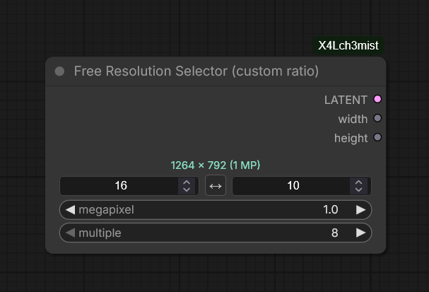
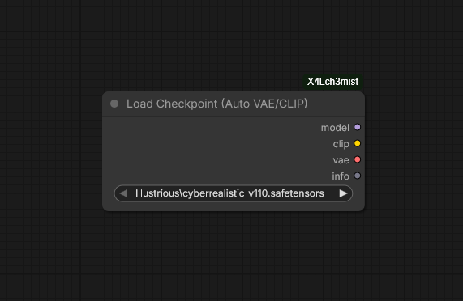
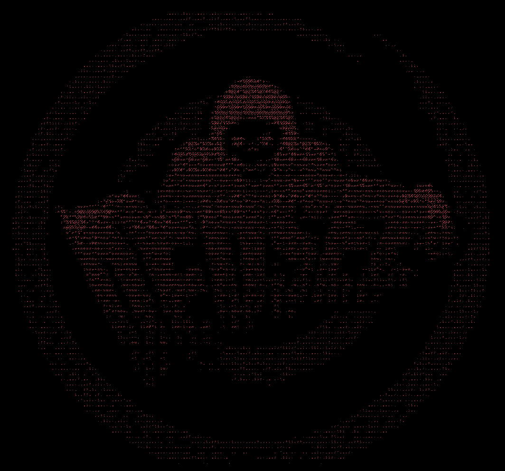

# ComfyUI-X4Lch3mist

Custom nodes for ComfyUI by X4Lch3mist. All nodes are found under the `X4Lch3mist` category.

## Nodes

### Free Resolution Selector (custom ratio)



Like the built-in ResolutionSelector, but with a freely configurable aspect ratio instead of a fixed dropdown. Target size in megapixels, rounding to a multiple of your choice, live resolution preview, swap button, and width/height as separate outputs.

→ [Details](free_resolution/README.md)

### Load Checkpoint (Auto VAE/CLIP)



Loads a checkpoint and automatically swaps in an external VAE and/or CLIP, based on a mapping file. Matches by file name, wildcard pattern or model architecture.

→ [Details and setup](auto_checkpoint/README.md)

### Dither 1-bit / ASCII Art



Turns an image into a 1-bit dither (stripes, Bayer, halftone, error diffusion) or into ASCII art with a monospace font. Black point, pattern and colors are adjustable, the output keeps the input resolution and includes a mask.

→ [Details](dither_ascii/README.md)

## Installation

### Via Git

```bash
cd ComfyUI/custom_nodes
git clone https://github.com/X4Lch3mist/ComfyUI-X4Lch3mist.git
```

Restart ComfyUI afterwards.

## License

GPL-3.0
