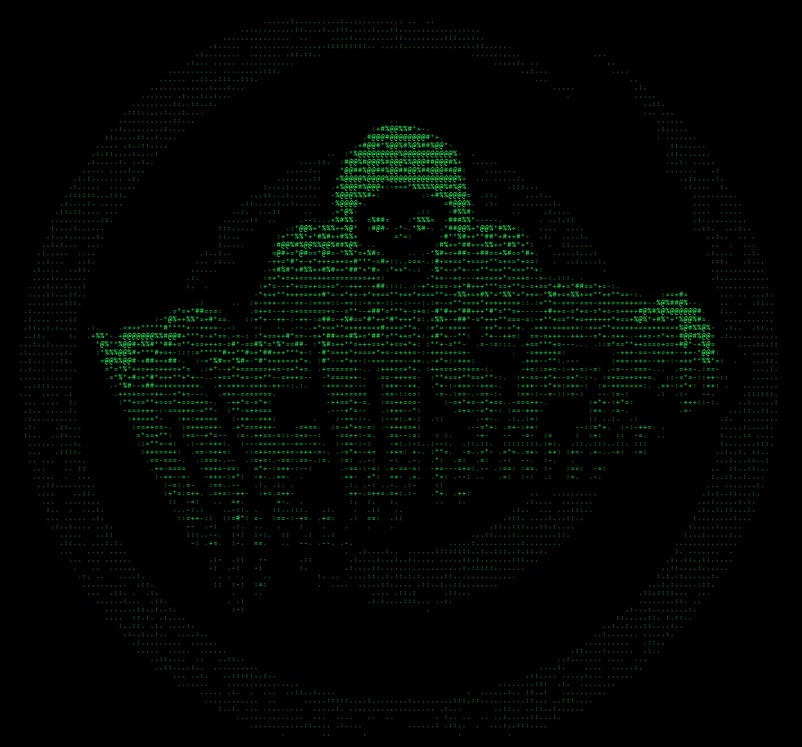
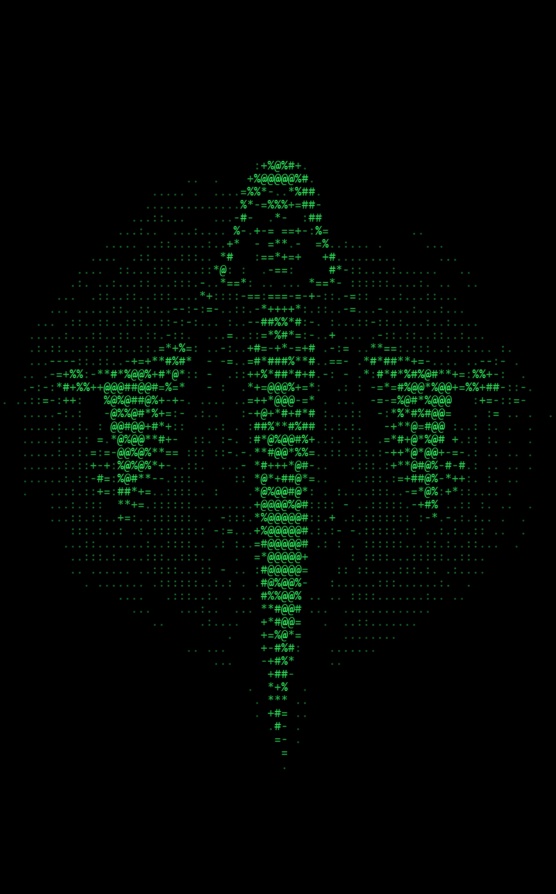

# Dither & ASCII (X4Lch3mist)

Two post-processing nodes for ComfyUI that give any image a retro hacker / print look.
No model, no GPU: pure NumPy + Pillow. A 1440×896 image takes well under a second.

Category: `X4Lch3mist/image`

## Dither 1-bit

Turns the image into two colours.

| Input | What it does |
|---|---|
| pattern | diagonal stripes, reverse diagonal, horizontal / vertical lines, crosshatch, bayer, halftone dots, floyd-steinberg, atkinson |
| pixel_size | size of one dither pixel. 1 = finest, 3–4 = chunky retro |
| pattern_size | period of stripes/dots in dither pixels (ignored by floyd-steinberg / atkinson) |
| smoothing | 0 = hard graphic lines, higher = finer tone steps (mixes in Bayer) |
| black_point | everything darker becomes solid background. Raise it if a dark background gets striped |
| white_point | everything brighter becomes solid foreground |
| gamma | >1 = more ink in the midtones, <1 = less |
| invert | swap light and dark |
| fg_color / bg_color | hex colours, e.g. `#FFFFFF` / `#000000` |

Outputs: `image`, `mask` (the 1-bit pattern, handy for compositing).

## ASCII Art

Maps brightness to characters and renders them in a monospace font.

| Input | What it does |
|---|---|
| charset | characters from dark to bright, first one = darkest (usually a space) |
| sort_by_density | re-orders the charset by real glyph ink, useful for custom sets |
| font_size | character height in px. Smaller = more detail |
| line_spacing | vertical gap between rows |
| black_point / white_point / gamma / invert | same as above |
| color_mode | `fade` (fg colour, dimmer in the dark), `fixed`, `source image` (each glyph takes the picture's colour) |
| fg_color / bg_color | default green on black |
| font_path (optional) | any .ttf/.otf. Empty = Consolas → Lucida Console → Courier New → DejaVu Sans Mono → Pillow default |

Outputs: `image`, `mask`, `text` (the plain ASCII text, e.g. for a Show Text node).

The output always keeps the input resolution, so it drops into any workflow.

Samples: 

## Tips

- Dark AI images: start with `black_point` 0.15–0.25 so the background stays clean.
- DedSec-like look: `diagonal stripes`, pixel_size 2, pattern_size 6–10, smoothing 0–0.2.
- Newspaper look: `halftone dots`, pixel_size 1, pattern_size 6.
- Long charset for fine ASCII: `` .'`^",:;Il!i><~+_-?][}{1)(|/tfjrxnuvczXYUJCLQ0OZmwqpdbkhao*#MW&8%B@$`` with sort_by_density on and font_size 8.
